<div align="center">
  <picture>
    <source media="(prefers-color-scheme: dark)" srcset="docs/assets/logo-dark.svg">
    
  </picture>

  <p><strong>English</strong> · <a href="README.zh-CN.md">简体中文</a></p>
  <h1>A general-purpose multi-agent desktop workspace</h1>
  <p>Give each Bot its own role, model and tools. Work with them one by one, in group chats, on your own files and in a local Linux computer.</p>
  <p>
    <a href="https://aelion.chat/?lang=en"><strong>Explore the website ↗</strong></a> &nbsp; · &nbsp;
    <a href="https://github.com/FoyonaCZY/AelionBot/releases/latest"><strong>Download for Windows and macOS</strong></a> &nbsp; · &nbsp;
    <a href="https://aelion.chat/blog/?lang=en">Blog</a>
  </p>
  <p><a href="https://github.com/FoyonaCZY/AelionBot/actions/workflows/ci.yml"></a></p>
  
</div>

<br>

**AelionBot is a general-purpose multi-agent desktop app.** Each Bot has its own role, model and tools. Give research, coding, writing, data analysis and design one partner each, send a task to a single Bot, or bring several into the same group. Work runs on your own computer: your files and commands under permissions you set, and a managed Linux work computer for browsers, terminals and office apps.

> **82.4% on Terminal-Bench 2.1** with Grok 4.5 (high), against 79.3% listed for the same model in Cursor CLI. [Details below](#terminal-bench-21).

For example, a product comparison for the team: the research partner collects sources into `research.md`, the data partner checks every figure and rebuilds the table, the writing partner turns the result into a one-page summary, and the design partner puts the table on a slide. You can add requirements at any time, or @ a partner to continue.

| Core capability | What it makes possible |
| --- | --- |
| **Group chats and Bot-to-Bot messages** | Assign roles, exchange files and results, and ask a partner to take the next step |
| **Work sessions** | Open several chats with the same Bot, each with its own folder and plan, and let them run at once |
| **Your computer and a Linux work computer** | Edit local files and run commands with approvals you control, or give a Bot a browser, terminal and desktop apps in a managed VM |
| **Design in every Bot** | Prototypes, presentations and site clones with 152 bundled design systems and a font library |
| **AI games** | Twelve-player Werewolf with human and AI seats, and personalities that grow across matches |
| **Command line** | The same engine runs headless, so a Bot can work in a terminal or a benchmark harness |

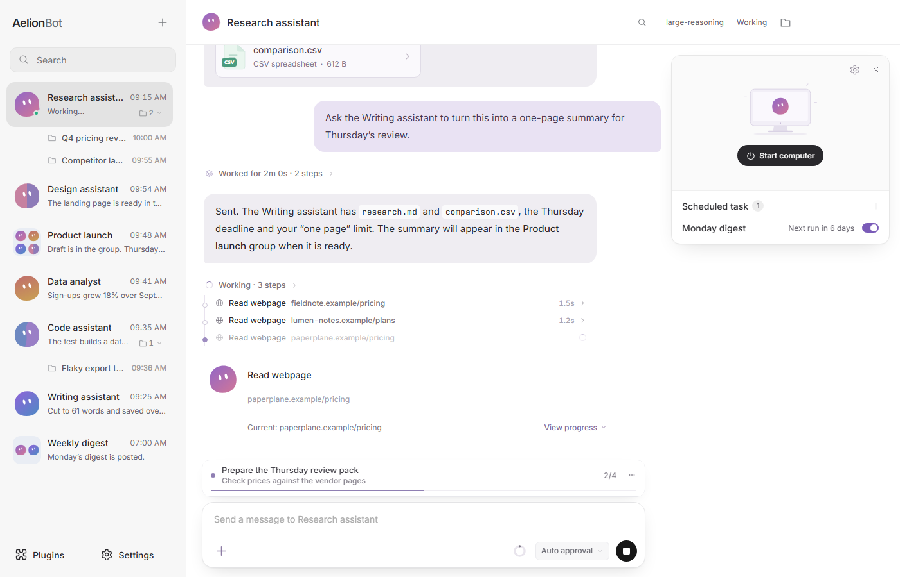

## Everyday work

Open a Bot and ask. It works in steps you can follow: searching, reading, writing files and running commands appear as a folded line under your message, with the answer and its files below. Long jobs can start with a plan you approve (`/plan`), or run toward a goal until it is done or blocked (`/goal`).

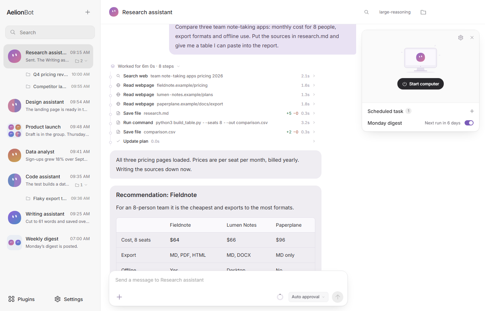

- **Work sessions.** Start more chats with the same Bot from the “+” menu or its context menu. Each session has its own history, working folder, permission mode and plans, while long-term memory stays shared. Sessions of one Bot work at the same time; a message only interrupts the chat it was sent in.
- **Scheduled tasks.** Run a task once, daily, weekly or at an interval, in the chat that created it. Keep the app open while it runs.
- **Memory and personality.** Each Bot keeps a SOUL.md that defines its voice and boundaries, and remembers what you confirm.
- **Light and dark themes**, in English, Simplified Chinese and Traditional Chinese.

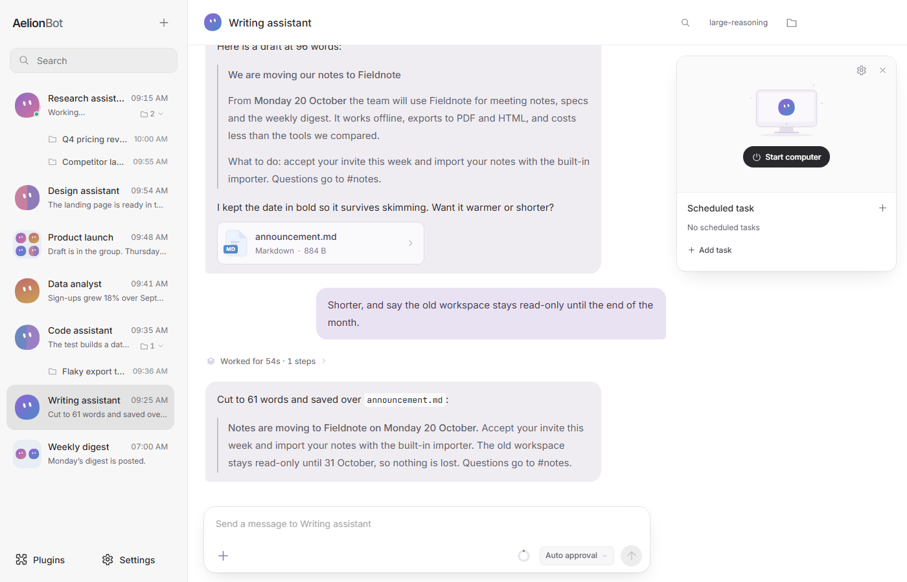

## Multi-agent collaboration

Give each job its own Bot, add them to the same group, and share the messages, sources and files that belong to the task. A group works from its own context and never mixes in unrelated private chats. Partners can also message each other and pass files. You decide who does what; the app never reassigns a partner's job on its own.

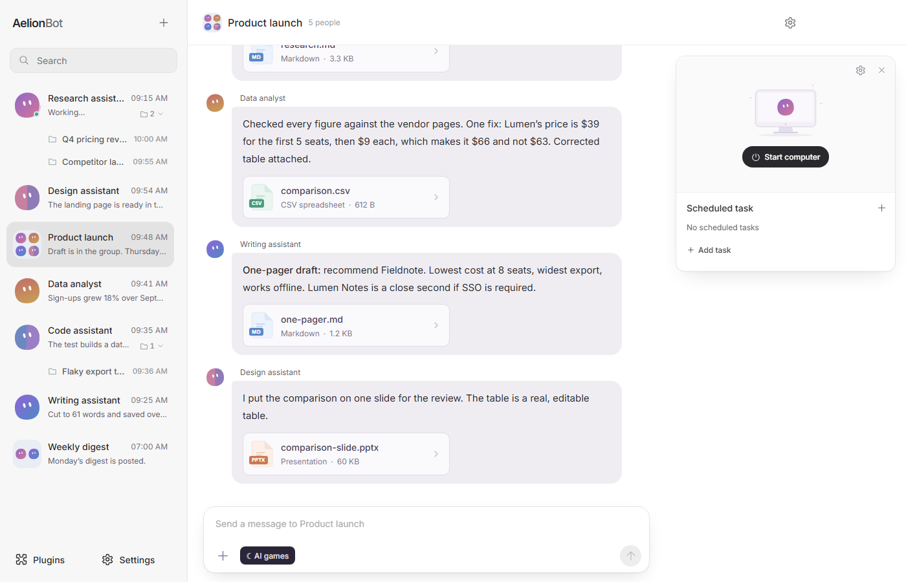

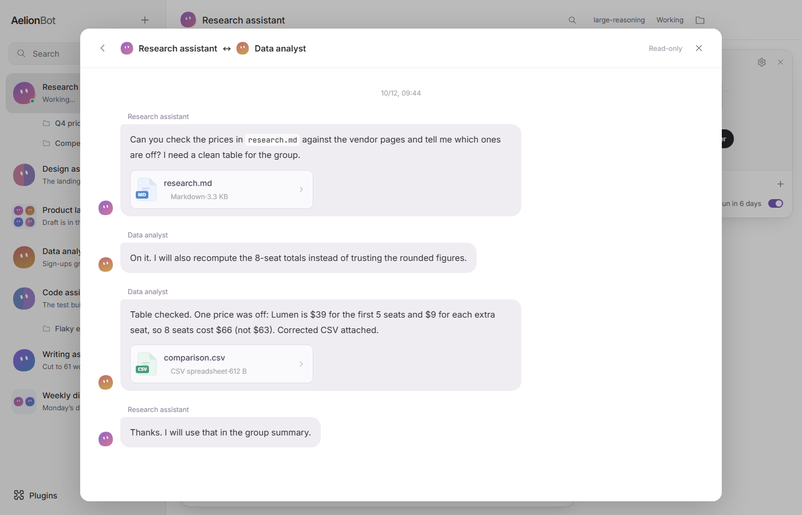

## Your computer, with approvals

A Bot can read and write files in a folder you pick and run commands on your computer. Each chat has a permission mode: **Ask each time**, **Auto approval** (the default: ordinary reads and writes in the project go through, while sensitive or out-of-bounds steps and MCP calls are checked by a review model) or **Full access**. “Always allow” saves a command-prefix rule for that folder. A request shows exactly what will run and where.

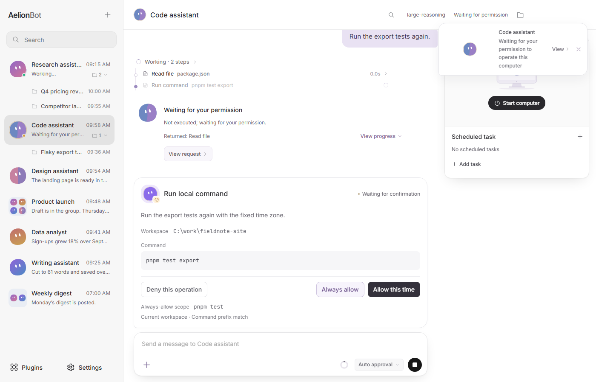

## Work computer (Linux VM)

When a task needs a browser, a desktop app or a clean environment, a Bot can use a managed Linux VM with a browser, a terminal and office apps:

> “Find three industry examples. Save their sources and key data in a brief, then design a one-page summary from it.”

Each Bot has its own workspace and desktop. You can watch the work, pause it, or take over the desktop. A web service running inside the VM opens in the app's preview through port forwarding. Follow the in-app guide to prepare and start the work computer; storage limits and reclaiming are in Settings.

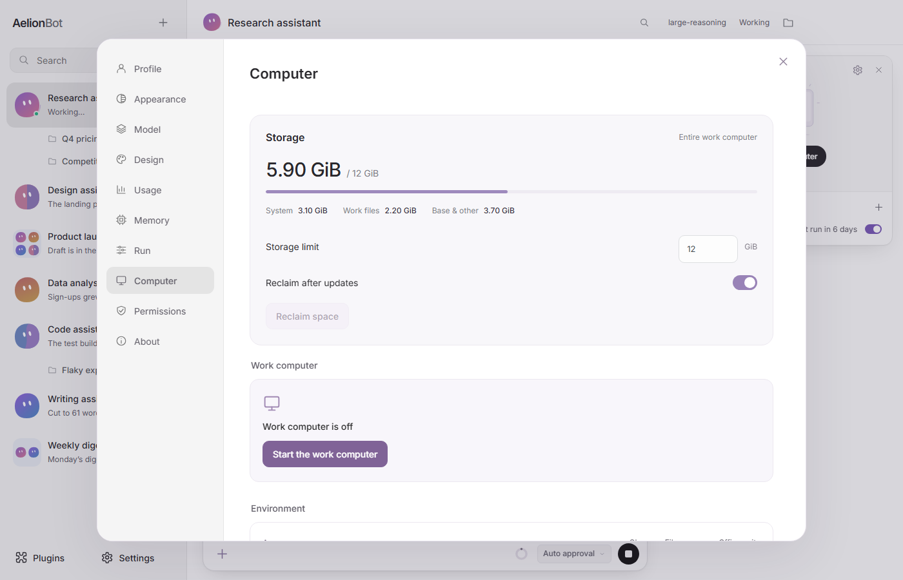

## Design work

Ask any Bot for a prototype, a presentation, a website clone, a mobile screen or a multi-page document. The design appears in a canvas card under the computer card, with a thumbnail of the page; click it to see the page beside the chat. Close the task and the conversation carries on as usual.

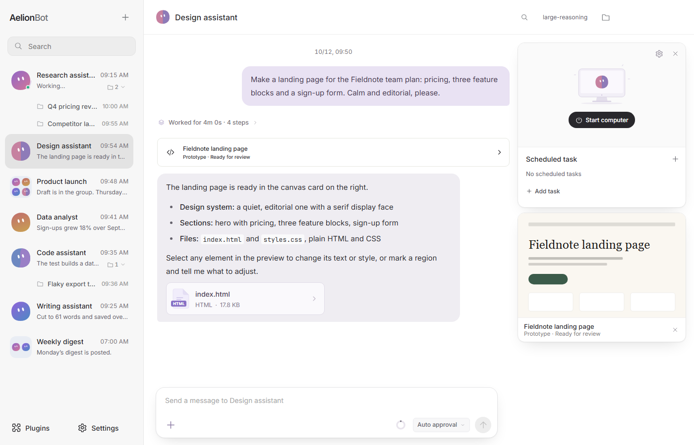

- **Design systems are built in.** All 152 references (color, typography, layout and component guidance) ship with the app, with no separate download. The Bot picks one, or none, and the fonts that fit the brief, and asks you when it is unclear. Settings → Design shows the library as specimens you can search and filter, and imports your own DESIGN.md folders.
- **Fonts.** The font library downloads Fontsource fonts or imports your own, previews each in its own face, and lets the Bot use them offline.
- **What you get.** Prototypes and site clones keep their HTML, CSS and JS. Presentations are editable PPTX files, with an HTML preview. Clone tasks also write NOTES.md with the source URL and what was not copied.
- **Edit in the preview.** Mark a region and leave a note, or select page elements and change their properties or source before saving.
- Design tasks live under `designers/<bot>/<task>` in the default workspace and do not need the VM.

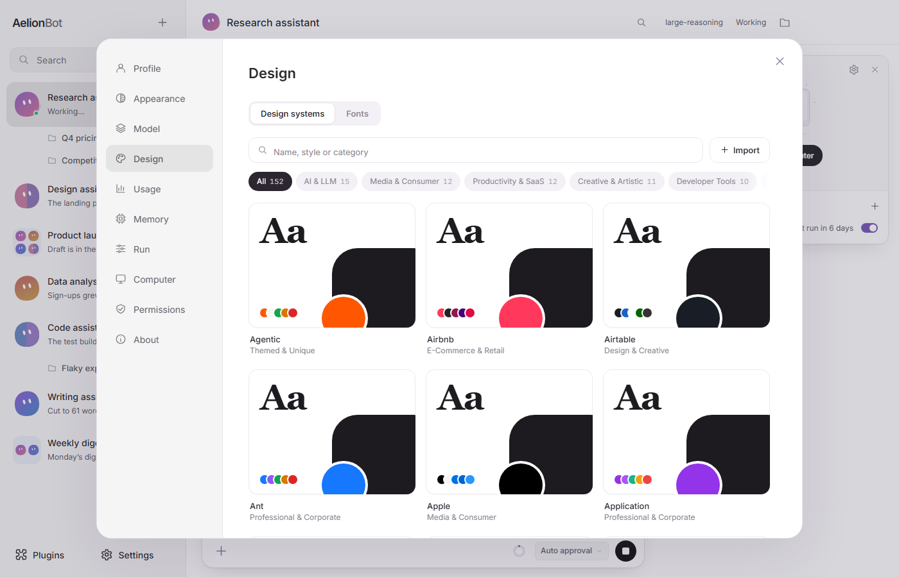

The design references come from OpenDesign, with source and license notices retained. Brand-inspired references do not imply official endorsement. See [third-party notices](docs/THIRD-PARTY-NOTICES.md).

## Files and previews

Browse the file tree and preview webpages, images, PDFs and supported documents beside the conversation, or expand to a full canvas. Code and text can be edited in place. Webpages support element selection, region annotations, undo and save. Message attachments can be saved as new copies.

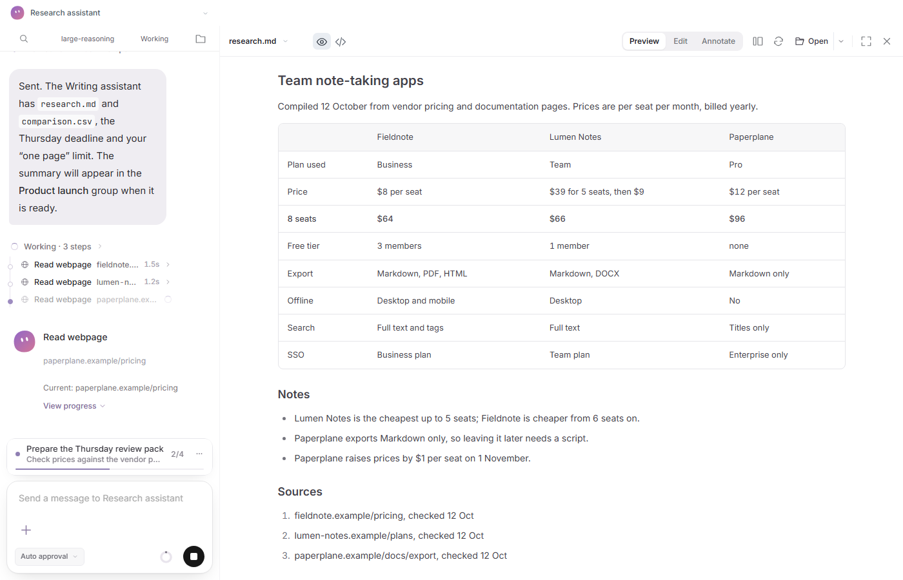

## AI games

Group chats have an “AI games” entry. The first game is twelve-player Werewolf with a sheriff: election, badge passing, night actions, speeches, voting and win resolution, on two boards (Seer/Witch/Hunter/Idiot or Seer/Witch/Hunter/Guard, each with 4 wolves and 4 villagers).

- Take a seat yourself or watch an all-AI table. Empty seats fill with temporary Bots in one click, and each AI player's model can be set individually or in batch.
- Bots have **personality profiles**: five traits, birth values, growth across matches, relationships and shared experiences. Growth uses evidence from actual actions, and every change can be inspected and undone.
- The wolf team holds a three-round night discussion. Each player sees only what their role should see.
- Games can be paused, resumed and finished, and survive an app restart. If a model call fails, the game pauses and keeps completed choices.

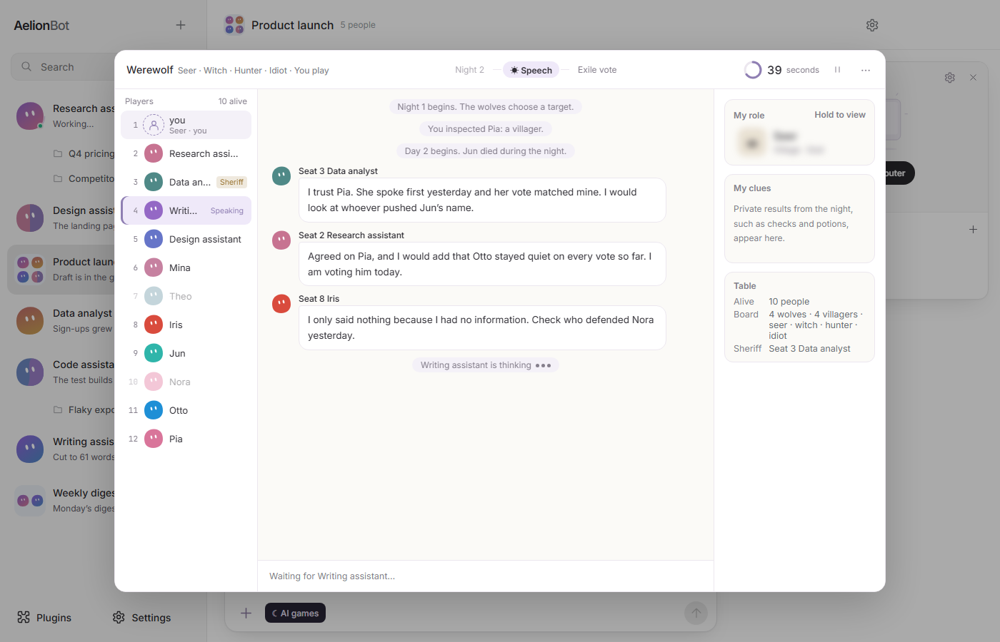

## Models, skills and plugins

- **Models:** OpenAI-compatible APIs, the Responses API, Anthropic and Gemini, plus local models. Use your own API keys, set a default model and a separate approval model, and override the model or reasoning effort per Bot.
- **Skills:** eight skills ship with the app: web research, data analysis, documents, spreadsheets, presentations, PDFs, web and interface design, and code development.
- **MCP:** add MCP servers from the Plugins page; their tools are available to Bots under your permission settings.

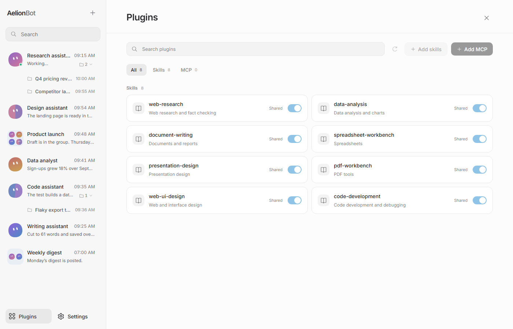

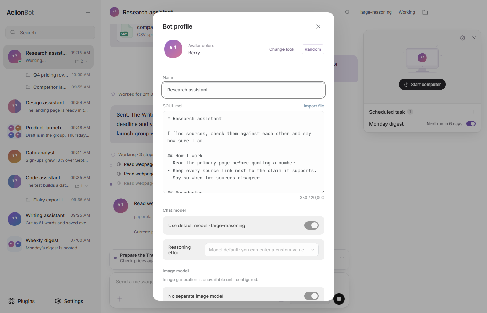

## Terminal-Bench 2.1

AelionBot's engine also runs without the desktop app. `node dist-electron/cli.cjs` (`pnpm run headless`) runs one Bot task against a project folder with the same tools, planning and permission checks, so it fits terminals and benchmark harnesses. We ran [Terminal-Bench 2.1](https://www.tbench.ai/news/terminal-bench-2-1), 89 hard command-line tasks that each have their own tests, through it:

| Setup | Terminal-Bench 2.1 |
| --- | --- |
| **AelionBot + Grok 4.5 (high)**, our run | **82.4%** (220 of 267 trials) |
| Cursor CLI + Grok 4.5 (high), [official leaderboard](https://tbench.ai/leaderboard/terminal-bench/2.1) | 79.3% ±1.5 |

Same model and reasoning effort, higher score. This is our own run with 3 attempts per task, not a leaderboard entry, and its 95% confidence interval (75.6–89.2%) overlaps the official figure, so read it as on par or better. The method, per-task results and the scripts to reproduce it are in [docs/terminal-bench.md](docs/terminal-bench.md).

```sh
pnpm run build
export AELION_API_KEY=...   # read only from the environment
node dist-electron/cli.cjs "fix the failing test" --workspace . --model <name> --base-url https://api.example.com/v1
```

Add `--permission auto` or `full` to let the run approve more on its own, `--timeout <seconds>` to bound it and `--json` for a machine-readable result. Anything that would need a person is denied and returned to the model.

## Get started

1. [Download AelionBot](https://github.com/FoyonaCZY/AelionBot/releases/latest) for Windows or macOS.
2. Connect a model service and follow the guide. The app itself is free; usage charges come from the service you choose. Local models work too.
3. Give a Bot a task: research, writing, code, or a prototype, presentation or website clone.
4. For group work, create a group chat, add partners, share materials and assign the work.

System requirements: Windows 10 or later (64-bit), or macOS on Intel and Apple silicon. The work computer (Linux VM) needs about 4 GB of memory and tens of GB of free disk. 16 GB of RAM or more is recommended.

## FAQ

- Can I preview external Office files? Presentations made in design tasks can be viewed through their HTML companion. Other Office files open in the preview once the work computer is running, or can be downloaded.
- Does it work offline? Bundled design references and fonts you have downloaded can be used offline. Model services and external assets may still need an internet connection.
- Where do my files and chats live? On your computer. Model calls go to the service you choose.
- The download seems different from this page? This README describes the current source. See the release notes for what each build includes.

## Development

Use Node.js 24 and pnpm 12.5.1 (pinned in `package.json`). Install pnpm with the [official installation instructions](https://pnpm.io/installation), then run:

```sh
pnpm install --frozen-lockfile
pnpm run typecheck
pnpm test
pnpm run build
pnpm run dev
```

Commit dependency changes together with `pnpm-lock.yaml`; do not generate an npm lockfile. Dependency build permissions are reviewed in `pnpm-workspace.yaml`. Preparing the Linux work computer requires `pnpm run vm:prepare-runtime`; see [release instructions](docs/RELEASING.md) for complete packages.

## Explore further

[Website](https://aelion.chat/?lang=en) · [Releases](https://github.com/FoyonaCZY/AelionBot/releases) · [Blog](https://aelion.chat/blog/?lang=en) · [Feedback](https://github.com/FoyonaCZY/AelionBot/issues)

Implementation: [Design work](docs/design-work.md) · [VM storage](docs/vm-storage.md) · [Terminal-Bench](docs/terminal-bench.md) · [Website development](website/README.md)

<sub>Screenshots are taken from the current app frontend; example conversations and files are fictional. The Bot artwork at the top is a brand illustration.</sub>
