<div align="center">
  <picture>
    <source media="(prefers-color-scheme: dark)" srcset="docs/assets/logo-dark.svg">
    
  </picture>

  <p><a href="README.md">English</a> · <strong>简体中文</strong></p>
  <h1>通用多 Agent 桌面工作空间</h1>
  <p>每个 Bot 有自己的职责、模型和工具。一对一交办，也可以拉进群聊协作，在你自己的文件和本地 Linux 工作电脑上完成工作。</p>
  <p>
    <a href="https://aelion.chat/?lang=zh-CN"><strong>逛逛官网 ↗</strong></a> &nbsp; · &nbsp;
    <a href="https://github.com/FoyonaCZY/AelionBot/releases/latest"><strong>下载 Windows 与 macOS 版</strong></a> &nbsp; · &nbsp;
    <a href="https://aelion.chat/blog/?lang=zh-CN">博客</a>
  </p>
  <p><a href="https://github.com/FoyonaCZY/AelionBot/actions/workflows/ci.yml"></a></p>
  
</div>

<br>

**AelionBot 是一个通用多 Agent 桌面应用。** 每个 Bot 可以单独配置职责、模型和工具。调研、代码、写作、数据分析和设计可以各安排一位伙伴，单独交办任务，或者把几位拉进同一个群协作。工作在你自己的电脑上完成：本机文件和命令按你设置的权限执行，需要浏览器、终端和办公应用时，用一台受管理的 Linux 工作电脑。

> **Terminal-Bench 2.1 成绩 82.4%**（Grok 4.5 high），高于榜单上同一模型搭配 Cursor CLI 的 79.3%。[详情见下文](#terminal-bench-21)。

举个例子，做一份给团队的产品对比：研究伙伴收集来源，整理成 `research.md`；数据伙伴逐项核对数字、重做对比表；写作伙伴把结论写成一页纸摘要；设计伙伴把表格做成一页幻灯片。中途你可以随时补充要求，或者用 @ 指定某位伙伴继续处理。

| 核心能力 | 可以做什么 |
| --- | --- |
| **群聊与 Bot 私信** | 按角色分工、交换文件与结果，指定伙伴接手 |
| **工作会话** | 和同一个 Bot 开多个对话，各有自己的目录和计划，可以同时进行 |
| **本机与 Linux 工作电脑** | 在你控制的审批下编辑本机文件、运行命令；也可以让 Bot 在受管理的 VM 里使用浏览器、终端和桌面应用 |
| **每个 Bot 都能做设计** | 用 152 套内置设计系统和字体库制作网页原型、PPT 与网站复刻 |
| **AI 游戏** | 十二人狼人杀，真人和 AI 同桌，AI 的性格会跨局成长 |
| **命令行** | 同一套引擎可以无界面运行，在终端或评测框架里工作 |

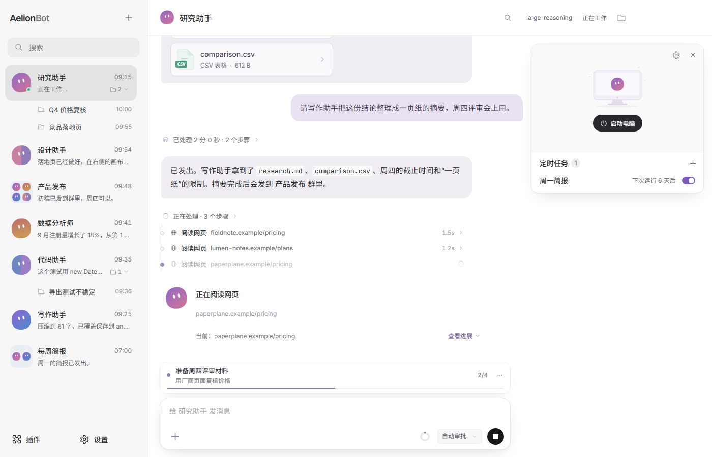

## 日常工作

打开一个 Bot 直接说需求。它的工作按步骤呈现：搜索、阅读、写文件、运行命令，折叠成消息下方的一行，答案和文件放在后面。较长的任务可以先出计划，由你确认后再执行（`/plan`），也可以设定目标，持续工作直到完成或遇到阻碍（`/goal`）。

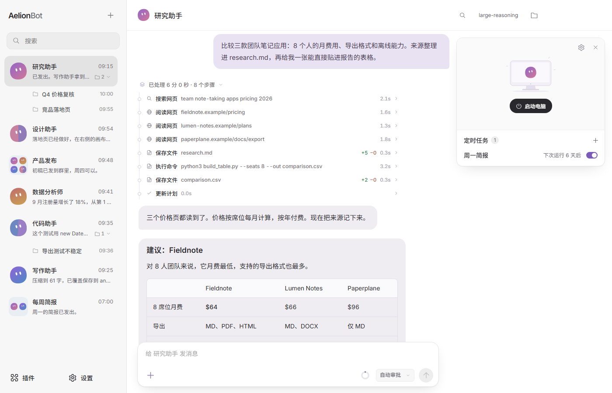

- **工作会话。** 从“+”菜单或 Bot 的右键菜单给同一个 Bot 新建对话。每个会话有自己的记录、工作目录、权限模式和计划，长期记忆仍然共享。同一个 Bot 的多个会话可以同时工作，发消息只会打断当前这个会话。
- **定时任务。** 一次性、每天、每周或按间隔执行，在创建它的对话里运行。执行期间需要保持应用开启。
- **记忆与个性。** 每个 Bot 有一份 SOUL.md，定义说话方式和边界，也会记住你确认过的工作偏好。
- **浅色和深色主题**，支持英语、简体中文和繁体中文。

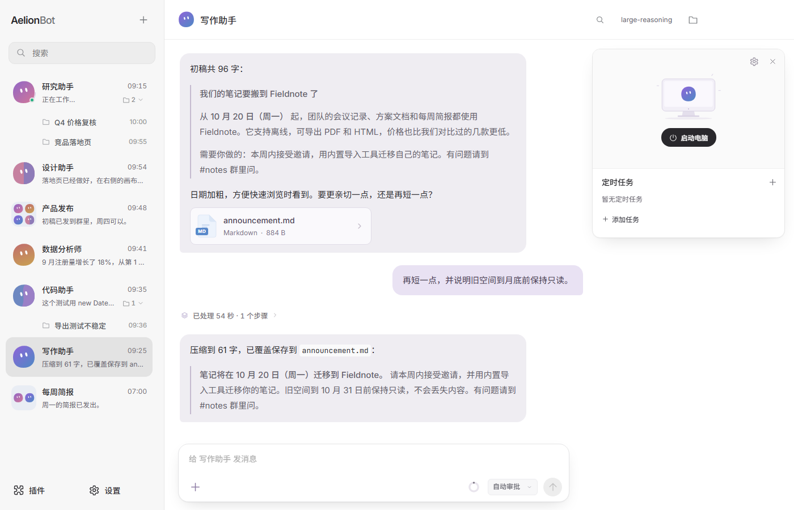

## 多 Agent 协作

为每项工作安排一个 Bot，加入同一个群，共享与任务有关的消息、资料和文件。群聊围绕群内上下文工作，不会混入无关的私聊记录。伙伴之间也能互发私信、传递文件。谁负责什么由你决定，应用不会擅自改变伙伴的分工。

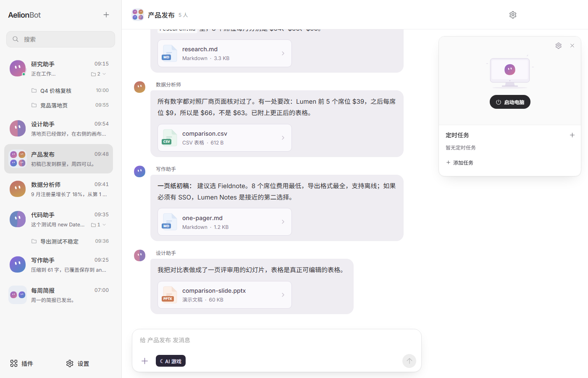

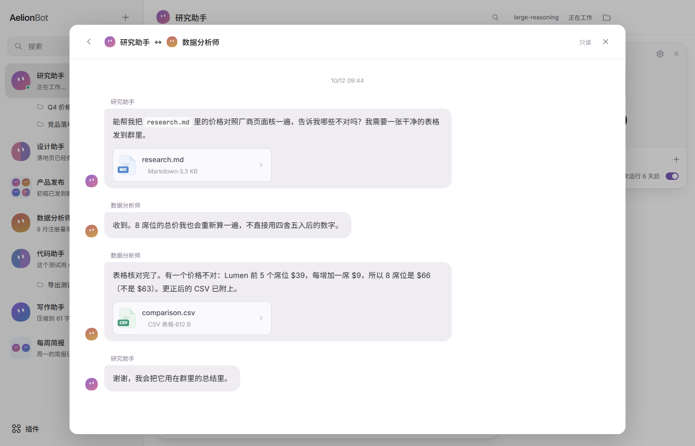

## 本机操作与审批

Bot 可以读写你指定文件夹里的文件，并在你的电脑上运行命令。每个对话有自己的权限模式：**每次询问**、**自动审批**（默认：项目内的普通读写直接放行，敏感或越界的操作和 MCP 调用由审核模型审核）和**完全访问**。“始终允许”会为这个文件夹保存一条命令前缀规则。每个请求都会写明要执行什么、在哪里执行。

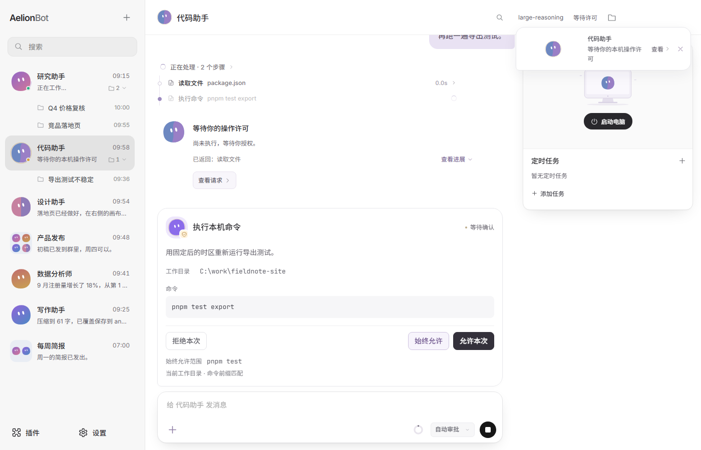

## 工作电脑（Linux VM）

任务需要浏览器、桌面应用或干净的环境时，Bot 可以使用一台受管理的 Linux VM，里面有浏览器、终端和办公应用：

> “收集三个行业案例，整理出处和关键数据，再据此设计一页摘要。”

各 Bot 有自己的工作目录和桌面。你可以查看工作过程，也可以暂停或接管桌面。VM 里启动的网页服务可以通过端口转发在应用内预览。按应用内引导准备并启动工作电脑；存储上限和回收空间都在设置里。

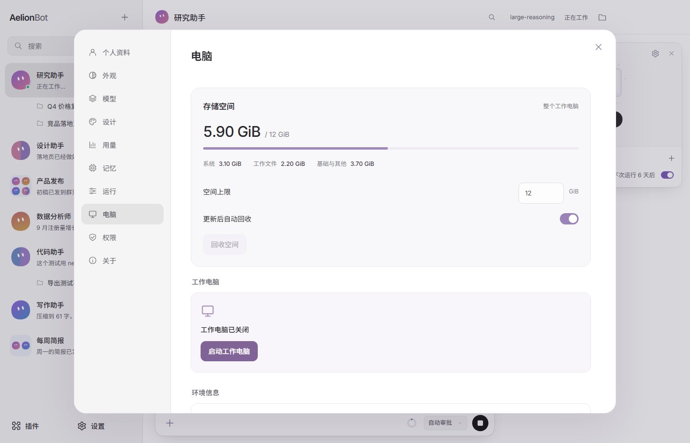

## 设计工作

向任何 Bot 要原型、PPT、网站复刻、移动端页面或多页文档。设计稿以缩略图显示在右上角电脑卡片下方的画布卡片里，点开后在对话旁查看页面。关闭任务后，对话照常继续。

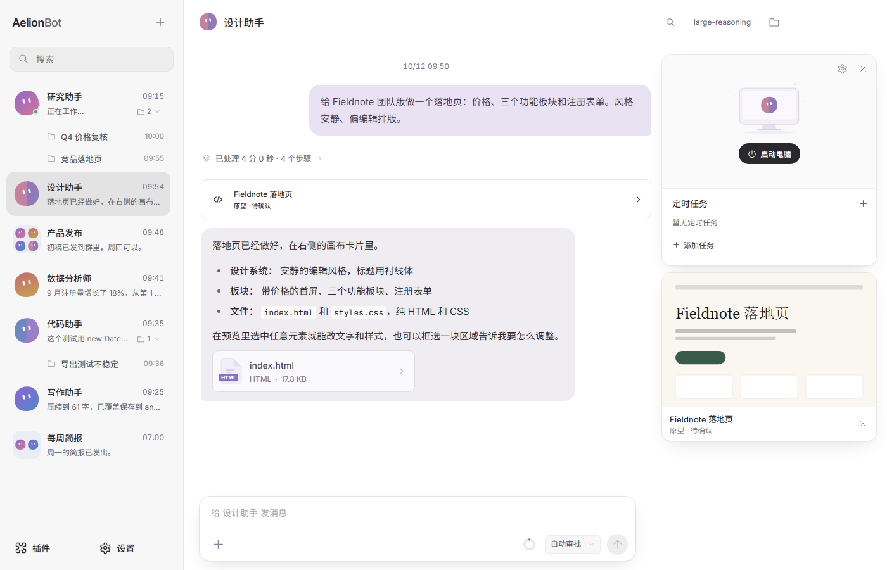

- **设计系统已内置。** 152 套设计参考（配色、字体、布局约定和组件参考）随应用预装，不用另外下载。用哪一套、哪些字体都由 Bot 按需求决定，也可以不用设计系统；拿不准时会先问你。设置 → 设计里可以搜索、按分类筛选，也可以导入自己的 DESIGN.md 文件夹。
- **字体库。** 下载 Fontsource 开源字体或导入自己的字体，每个字体用自身字形预览，Bot 可以离线取用。
- **交付物。** 网页原型与网站复刻保留 HTML/CSS/JS；演示交付可编辑的 PPTX，并带 HTML 预览。复刻任务会写 NOTES.md，说明来源和未克隆的部分。
- **在预览里修改。** 框选区域留下批注，或者选中网页元素修改属性和源码后保存。
- 设计任务在默认工作目录的 `designers/<bot>/<task>` 下进行，不需要启动 VM。

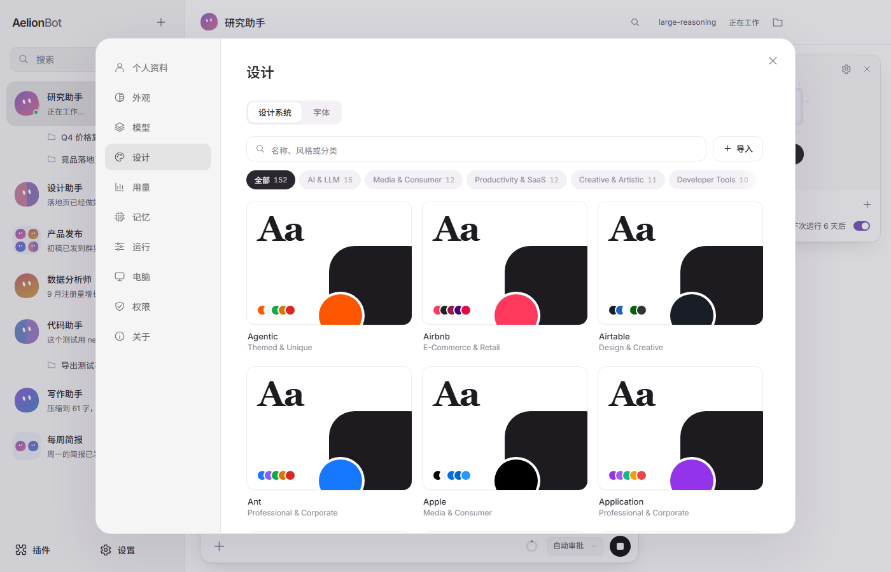

设计系统来自 OpenDesign 的整理资源，保留了原始来源和许可说明。品牌风格参考不代表品牌官方合作，详见[第三方声明](docs/THIRD-PARTY-NOTICES.md)。

## 文件与预览

文件目录、网页、图片、PDF 和支持的文档都可以在对话旁边预览，也可以展开成大画布。代码和文字能直接编辑，网页支持元素选择、框选标注、撤销和保存。消息附件可以另存副本。

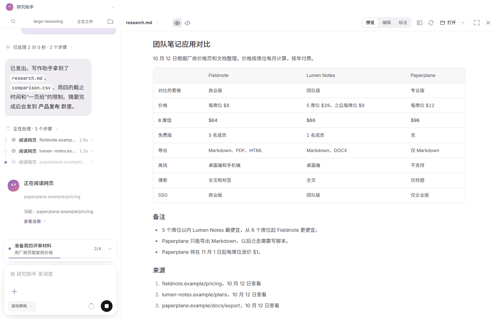

## AI 游戏

群聊里有「AI 游戏」入口，目前是十二人狼人杀：12 座、有警长，包含警长竞选、警徽流转、夜间行动、发言、投票和胜负结算。板子有两个：预女猎白（4 狼 4 民，预言家、女巫、猎人、白痴）和预女猎守（4 狼 4 民，预言家、女巫、猎人、守卫）。

- 可以真人上桌，也可以只旁观全 AI 对局；座位不够时一键用临时 Bot 补齐，每个 AI 玩家可以单独或批量指定模型。
- Bot 有**人格档案**：五维性格、出生值、跨局成长、关系和共同经历。成长依据来自实际行动，每次变化都能查看依据并撤回。
- 狼队夜间分提议、回应、确认三轮讨论；每个玩家只看到自己角色该看的信息。
- 对局可以暂停、恢复、结束，应用重启后也能接着来。模型调用失败时会暂停，已完成的选择保留。

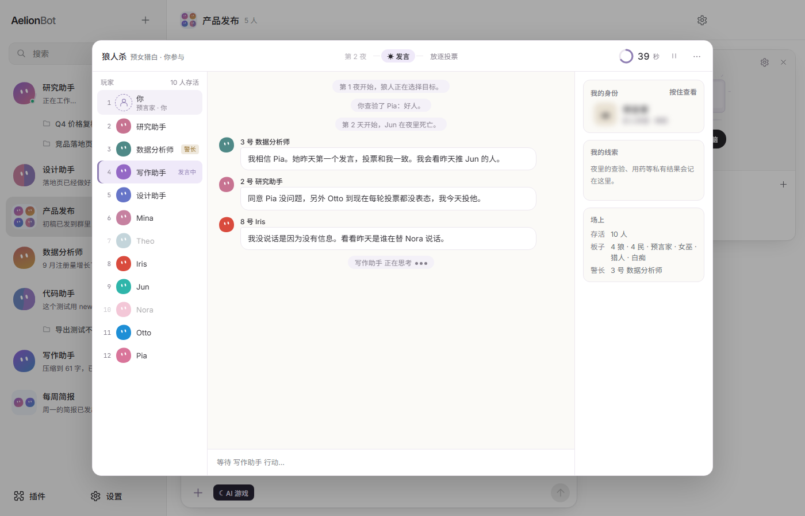

## 模型、技能与插件

- **模型：** 兼容 OpenAI 接口、Responses API、Anthropic 和 Gemini，也支持本地模型。用自己的 API Key，可设置默认模型和单独的审批模型，每个 Bot 还能单独指定模型和推理强度。
- **技能：** 应用附带八个技能：网页调研、数据分析、文档、表格、演示文稿、PDF、网页与界面设计、代码开发。
- **MCP：** 在插件页添加 MCP 服务，它们的工具按你的权限设置提供给 Bot。

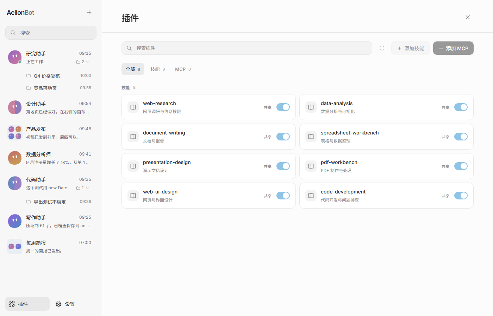

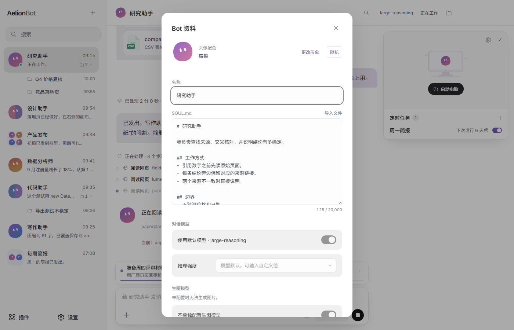

## Terminal-Bench 2.1

AelionBot 的引擎也可以脱离桌面应用运行。`node dist-electron/cli.cjs`（`pnpm run headless`）用同一套工具、规划和权限检查，对一个项目文件夹完成一件 Bot 任务，适合终端和评测框架。我们用它跑了 [Terminal-Bench 2.1](https://www.tbench.ai/news/terminal-bench-2-1)：89 道各带测试的高难度命令行任务。

| 配置 | Terminal-Bench 2.1 |
| --- | --- |
| **AelionBot + Grok 4.5（high）**，我们自己的运行 | **82.4%**（267 次试验通过 220 次） |
| Cursor CLI + Grok 4.5（high），[官方榜单](https://tbench.ai/leaderboard/terminal-bench/2.1) | 79.3% ±1.5 |

同一个模型、同样的推理强度，成绩更高。这是我们自己的一次运行，每题 3 次，不是榜单条目；它的 95% 置信区间（75.6–89.2%）和官方数字有重叠，所以更准确的理解是“不低于官方成绩”。方法、逐题结果和复现脚本见 [docs/terminal-bench.md](docs/terminal-bench.md)。

```sh
pnpm run build
export AELION_API_KEY=...   # 只从环境变量读取
node dist-electron/cli.cjs "修好失败的测试" --workspace . --model <模型名> --base-url https://api.example.com/v1
```

加 `--permission auto` 或 `full` 让这次运行自己批准更多操作，`--timeout <秒>` 限定时长，`--json` 输出机器可读的结果。需要人确认的操作一律拒绝，并把结果返回给模型。

## 开始使用

1. [下载 AelionBot](https://github.com/FoyonaCZY/AelionBot/releases/latest)，选择适合电脑的 Windows 或 macOS 版本。
2. 连接模型服务，按引导配置。应用本身不收费，模型调用费用由所选服务收取；也可以用本地模型。
3. 交给 Bot 一件任务：调研、写作、代码，或者原型、PPT、网站复刻。
4. 需要多人协作时创建群聊，加入伙伴，分享材料并分配工作。

系统要求：Windows 10 及以上（64 位）或 macOS，Intel 与 Apple 芯片都支持。工作电脑（Linux VM）大约需要 4 GB 内存和几十 GB 可用磁盘，电脑内存建议 16 GB 或更多。

## 常见问题

- 外部 Office 文件能直接预览吗？设计任务生成的演示可以通过 HTML 版本查看。其他 Office 文件在工作电脑启动后可以预览，也可以下载后查看。
- 离线能用吗？预装的设计参考和已下载的字体可以离线使用，模型服务和外部素材可能仍需联网。
- 我的文件和对话存在哪里？在你自己的电脑上。模型调用会连接你选择的服务。
- 下载包和这里写的不一样？本文描述的是当前源码的能力，下载包以对应版本的发布说明为准。

## 本地开发

使用 Node.js 24 和 pnpm 12.5.1（版本固定在 `package.json`）。按 [pnpm 官方说明](https://pnpm.io/installation) 安装后，在仓库根目录运行：

```sh
pnpm install --frozen-lockfile
pnpm run typecheck
pnpm test
pnpm run build
pnpm run dev
```

修改依赖时一起提交 `pnpm-lock.yaml`，不要生成 npm 锁文件。依赖构建脚本的批准配置在 `pnpm-workspace.yaml`。使用 Linux 工作电脑前还需运行 `pnpm run vm:prepare-runtime`；完整安装包的生成方式见[发布说明](docs/RELEASING.md)。

## 了解更多

[官网](https://aelion.chat/?lang=zh-CN) · [版本更新](https://github.com/FoyonaCZY/AelionBot/releases) · [博客](https://aelion.chat/blog/?lang=zh-CN) · [反馈建议](https://github.com/FoyonaCZY/AelionBot/issues)

开发与实现：[设计工作](docs/design-work.md) · [VM 存储管理](docs/vm-storage.md) · [Terminal-Bench](docs/terminal-bench.md) · [官网开发说明](website/README.md)

<sub>截图取自当前 App 前端，示例对话与文件是虚构的；顶部 Bot 形象为品牌插画。</sub>
